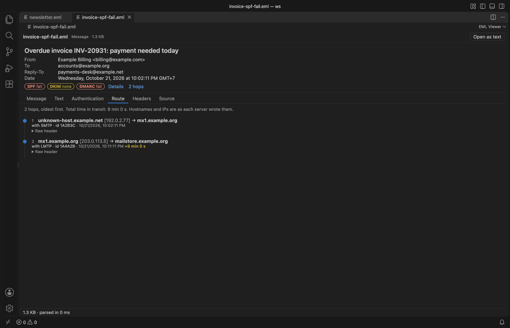
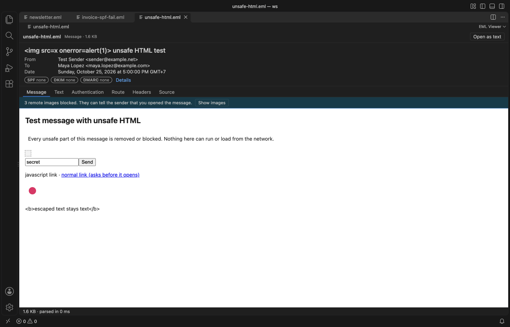

# EML Viewer & MBOX Email Viewer

Read saved `.eml`, `.emlx` and `.mbox` email files in VS Code the way a mail client shows them, with remote images blocked until you ask for them.

*Real output from VS Code 1.142 on macOS. The file is `newsletter.eml`, made by `scripts/make-samples.js` with made-up people at example.com. `scripts/e2e-vscode.mjs` installed the packaged extension in a clean VS Code profile, opened the file and saved the window through the debug port.*

- Opening a message doesn't tell the sender. Tracking pixels and other remote images stay blocked, and the bar says how many there are. One click shows them for that tab. Inline `cid:` images and attachments come from the file itself, so they always show.
- You can check where a message came from. The badges show the SPF, DKIM and DMARC results that the receiving server recorded, and the Route tab lists every Received hop with the delay between hops.
- Whole mailboxes open fast. A `.mbox` file is indexed as a stream, so the first 200 messages show while the rest is still being read. A 42 MB mailbox with 39,000 messages was fully indexed in 0.3 s in our test.
- Scripts in a message never run. The HTML body sits in a sandboxed frame without script rights, and scripts, frames, forms, meta refresh and `javascript:` links are removed first.

## Quick start

1. Install EML Viewer.
2. Click any `.eml`, `.emlx`, `.mbox` or `.mbx` file in the Explorer.

If another editor opens, right-click the file and pick "Open in EML Viewer", or use "Reopen Editor With..." from the editor title menu. That also works for mailboxes with no extension, such as Thunderbird's `Inbox` file. "EML Viewer: Get Started" in the Command Palette opens a short tour.

## What you see for each message

| Part | What it shows |
|---|---|
| Header card | Subject, From, To, Cc, Bcc, Reply-To (when it differs from From) and the date in your time zone |
| Badges | SPF, DKIM and DMARC results, green for pass, red for fail, yellow for none or neutral |
| Attachments | Name, size and a Save button. Names are cleaned, so a name can't point outside the folder you pick |
| Message | The HTML body in a sandboxed frame. Links ask before they open in your browser |
| Text | The plain text part, or text made from the HTML when there is none |
| Authentication | Each Authentication-Results header, every DKIM signature (domain, selector, algorithm), Received-SPF and the ARC chain |
| Route | Received hops, oldest first, with hostnames, IPs, protocol, TLS and the delay between hops. Hops over 5 minutes are marked |
| Headers | Every header line, with Copy |
| Source | The raw message (the first 2 MB), with Copy |

The results are the ones the receiving server wrote. EML Viewer doesn't query DNS or check signatures again, which keeps it offline. A message from a Sent folder or written by a script often has no Authentication-Results header, and the tab says so.

## Mailboxes

- Search matches sender, recipients and subject. Every word you type has to match.
- Sort by file order, newest or oldest first, sender, subject or size.
- The list shows 200 messages per page. Arrow keys, or J and K, move to the next and previous message.
- Each message is read from disk when you pick it, so a big mailbox doesn't fill memory.
- Both mboxo and mboxrd files work. A `From ` line only starts a new message at the top of the file or after a blank line, and `>From ` quoting is undone.

## Files and limits

| File | Notes |
|---|---|
| `.eml` | One RFC 822 message, as saved by Outlook, Thunderbird, Gmail and most other clients |
| `.emlx` | Apple Mail's format. The byte count line and the trailing property list are skipped |
| `.mbox`, `.mbx` | Mailboxes from Thunderbird, Gmail Takeout, Apple Mail export and mail servers |

Files over 4 GB show a message instead of opening. A single message over 200 MB (setting `emlViewer.maxMessageMB`) also shows a message, and "Open as text" in the toolbar opens the raw file either way. Outlook `.msg` and `.pst` files are not supported.

## Settings

| Setting | Default | What it does |
|---|---|---|
| `emlViewer.alwaysShowRemoteImages` | false | Load remote images in HTML messages without asking. |
| `emlViewer.maxMessageMB` | 200 | Largest single message that is parsed, in MB. |
| `emlViewer.askForRating` | true | Ask one time for a Marketplace rating after a few days of use. Nothing is sent anywhere. |
| `emlViewer.showSupportLinks` | true | Show the small Sponsor and More free viewers links in the status line. |

## Privacy and safety

EML Viewer makes no network calls and has no telemetry. The only requests it can cause are the remote images you choose to show and the links you confirm. The mail file is never written. The only files the extension writes are the attachments you save, and it refuses to save over the mail file itself.

The webview runs under a strict Content Security Policy. Its scripts need a per-load nonce, and the message frame has no script rights at all. Subjects, names and header values are shown as plain text, so a subject such as `` stays text.

## Support

Zovo extensions have no ads and no tracking, and sponsors pay for the time that goes into fixes and new viewers. You can sponsor the work on [GitHub Sponsors](https://github.com/sponsors/theluckystrike).

## More viewers by Zovo

- [Context Drift](https://marketplace.visualstudio.com/items?itemName=zovo.context-drift) finds stale facts in AGENTS.md, CLAUDE.md and other agent rule files.
- [PDF Viewer & Reader with Dark Mode](https://marketplace.visualstudio.com/items?itemName=zovo.pdf-viewer-dark) reads PDFs with a real dark mode, search, an outline and thumbnails.
- [CSV, Excel & Parquet Viewer](https://marketplace.visualstudio.com/items?itemName=zovo.table-viewer-vscode) opens Parquet, Excel and CSV files as a sortable, filterable table.
- [DOCX Viewer & Word Viewer](https://marketplace.visualstudio.com/items?itemName=zovo.docx-viewer-vscode) previews Word files with dark mode, an outline and search.
- [HDF5 & NetCDF Explorer](https://marketplace.visualstudio.com/items?itemName=zovo.hdf5-netcdf-explorer) browses groups, variables and attributes in scientific data files.
- [PPTX Viewer for PowerPoint](https://marketplace.visualstudio.com/items?itemName=zovo.pptx-slide-viewer) shows PowerPoint slides, thumbnails and speaker notes.
- [Skill Shelf](https://marketplace.visualstudio.com/items?itemName=zovo.skill-shelf) lists, checks and toggles the Agent Skills that Claude Code, Codex and Cursor load.
- [Tensor Viewer](https://marketplace.visualstudio.com/items?itemName=zovo.tensor-viewer) shows NPY, NPZ, Safetensors and GGUF tensors with stats and heatmaps.

Coming soon to the Marketplace, with the code on GitHub now.

- [JSONL Viewer](https://github.com/theluckystrike/jsonl-viewer-vscode) opens JSONL and NDJSON files as a table, as records or as a chat view.
- [SQLite Table Viewer](https://github.com/theluckystrike/sqlite-table-viewer) browses SQLite tables read-only and runs SELECT queries.
- [Agent Session Viewer](https://github.com/theluckystrike/agent-session-viewer) browses and searches your local Claude Code and Codex sessions.
- [Audio Preview & Loudness Meter](https://github.com/theluckystrike/audio-preview-vscode) plays audio files with a waveform, a spectrogram and LUFS loudness.
- [Video Preview with Sound](https://github.com/theluckystrike/video-preview-vscode) plays MP4, MOV, MKV and WebM files with their sound.
- [Graphviz Preview & DOT Viewer](https://github.com/theluckystrike/graphviz-preview-vscode) shows a live preview of DOT files and exports SVG or PNG.
- [TIFF Viewer](https://github.com/theluckystrike/tiff-viewer-vscode) opens 16-bit, float, multi-page and GeoTIFF images.
- [Avro, Arrow & Feather Viewer](https://github.com/theluckystrike/arrow-avro-viewer-vscode) opens Avro, Arrow and Feather files as a paged table.
- [3D Model Viewer](https://github.com/theluckystrike/model-viewer-vscode) views GLB, glTF, STL, OBJ, PLY and 3MF models.
- [File Viewers Pack](https://github.com/theluckystrike/zovo-file-viewers) installs the PDF, table, Word, PowerPoint, HDF5 and tensor viewers in one step.

## License

MIT. Messages are parsed with [postal-mime](https://github.com/postalsys/postal-mime) (MIT-0). See THIRD-PARTY-NOTICES.md.
